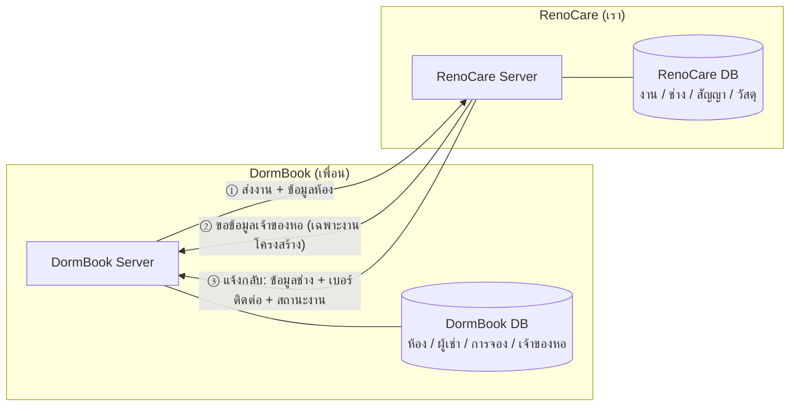
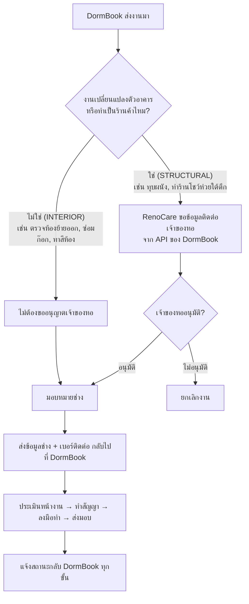
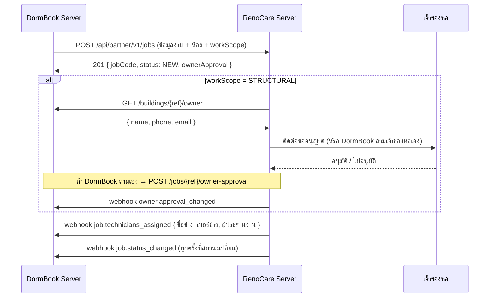

# RenoCare ↔ DormBook — ภาพรวมการเชื่อมต่อ (ฉบับคุยกัน)

> RenoCare = ระบบรับเหมาก่อสร้าง/ซ่อม (ของเรา) · DormBook = ระบบหาห้องและจองห้องพัก (ของเพื่อน)
> **แต่ละระบบมี server และ database ของตัวเอง คุยกันผ่าน API เท่านั้น** ไม่มีใครเข้า database ของอีกฝั่ง

## 1. ภาพรวมระบบ

## 2. แยก 2 กรณี

> งานโครงสร้าง: ช่างไปประเมินหน้างานได้ระหว่างรออนุมัติ แต่ **ส่งสัญญาและเริ่มงานไม่ได้** จนกว่าเจ้าของหอจะอนุมัติ

## 3. ลำดับการเรียก API

## 4. สิ่งที่แต่ละฝั่งต้องทำ

| | DormBook (เพื่อน) | RenoCare (เรา) |
| --- | --- | --- |
| เรียก API อีกฝั่ง | `POST /jobs` ส่งงาน, `POST /jobs/{ref}/owner-approval` (ถ้าถามเจ้าของหอเอง) | `GET /buildings/{ref}/owner` ขอข้อมูลเจ้าของหอ |
| เปิด API ให้อีกฝั่งเรียก | `GET /buildings/{ref}/owner` + URL รับ webhook | `/api/partner/v1/*` |
| คีย์ | ใช้ `X-API-Key` ที่ RenoCare ออกให้ | ใช้ `X-API-Key` ที่ DormBook ออกให้ |
| ข้อมูลที่ส่งออก | งาน, ห้อง, (ข้อมูลเจ้าของหอเฉพาะงานโครงสร้าง) | ข้อมูลช่าง, เบอร์ติดต่อ, สถานะงาน |

รายละเอียด field ทั้งหมด: [system-design.md ข้อ 5](system-design.md#5-สัญญาการเชื่อมต่อกับระบบจองห้องพัก-partner-api-v1)
